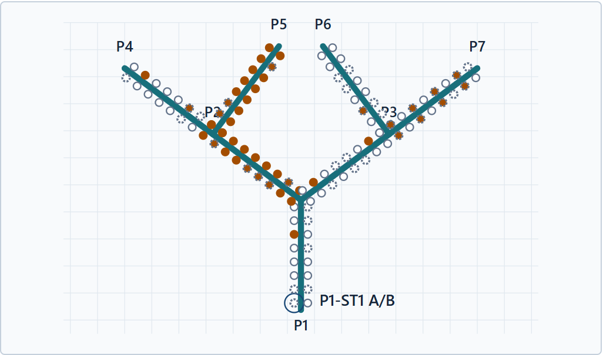
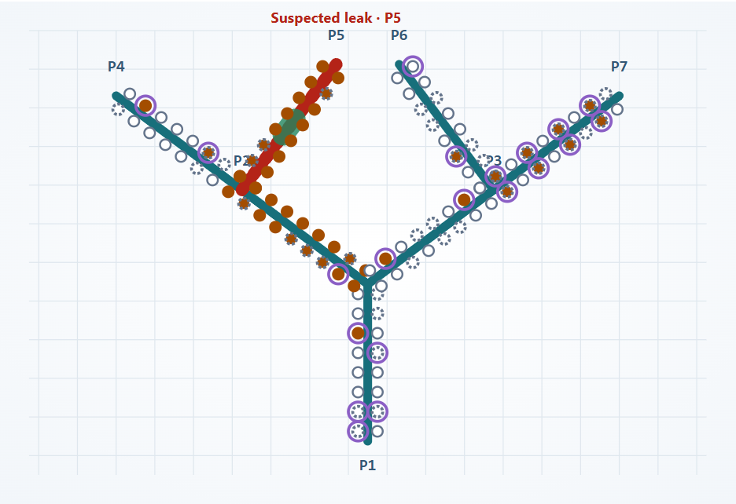

# Subsea Lens

**From pressure alerts to evidence-backed inspection decisions.**

[Run the demo](#run-the-demo) · [One-page brief](docs/ONE_PAGE_BRIEF.pdf) ·
[Dashboard (local)](http://127.0.0.1:8086/?tab=live) ·
[Evaluation (local)](http://127.0.0.1:8086/?tab=evaluation)

The local links open your own running demo after setup.

## The problem

Subsea pipelines carry oil and gas from offshore fields. Operators monitor pressure
along these pipelines to spot possible problems and decide when to intervene. A
missed leak can harm the marine environment, stop production and put operating
permissions at risk. But sending a vessel or underwater inspection team to
investigate faulty measurements can also be costly. The integrity engineer must
therefore distinguish a real pipeline problem from a measurement problem before
directing a response.

Making that distinction is difficult because different causes can produce similar
alerts. A pressure drop may indicate a leak, an operating change or a faulty
sensor; missing readings can obscure the picture. A leak and sensor faults may
also occur together. Before directing a response, the engineer must establish
what is happening, where attention is needed and whether the evidence is reliable
enough to act on. This turns each investigation into three practical questions:

1. Is this a leak, a change in operating or measurement conditions, or an instrument problem?
2. If a leak is suspected, which branch and section should be inspected?
3. What evidence supports that conclusion, and what still needs checking before a team is sent?

## From alerts to an investigation

The illustration below shows this challenge on a simulated 11.2 km network with
seven connected sections (P1-P7) and 112 pressure instruments. A leak on P5 occurs
alongside sensor faults, missing data and a shared data-connection problem on P7.
Both maps summarize the same 60-second slice of simulated readings of scenario S7
(see the Live tab of the dashboard), from 50 to 110 seconds into the replay, with
69 instruments flagged.



**Figure 1. Sensor alerts only.** Orange dots show unusual pressure; dashed dots
show missing or invalid readings. Question 1 requires comparing histories and
records to separate the P5 leak from P7's connection problem and sensor faults.
Question 2 requires tracing related pressure changes across branches to narrow
the inspection area. Question 3 requires checking sensor reliability and
documenting the supporting evidence. The map alone answers none of these:
repeated cross-checks take time and require knowledge of pipeline behavior.

Subsea Lens organizes these cross-checks with **three AI agents working in
sequence**. Sensor Quality checks reading reliability. Event Diagnosis uses that
assessment, pressure patterns and records to assess causes and inspection
priorities. Operator Response assembles the findings, evidence, uncertainties
and next checks into one report. A separate review checks the report against its
sources.



**Figure 2. The agents add an explanation to the alerts in Figure 1.** Red
highlights P5 because the report finds evidence of a possible leak there. Green
narrows the inspection priority to 700-900 m from P5's start. Purple rings identify
separate sensor or data concerns. These markings summarize the report.

The report explains which readings and records support each finding, considers
other possible causes and lists the next checks. The engineer can follow those
references, challenge the reasoning and decide what to inspect, instead of
assembling the investigation from individual alerts.

## Evaluation

Subsea Lens can generate reviewed reports in about **2.5-2.8 minutes**, as observed
in two controlled tests, helping engineers respond promptly to pipeline issues.

To test the system's answers, we compared its findings with known leaks and
instrument problems that were hidden from the agents. Across all evaluated
snapshots in the held-out synthetic detection test, leak detection achieved
**100% precision and recall, with no false leak alarms**. Identifying affected
instruments and classifying their problems also achieved **100% precision and recall**.

See the [same-input dashboard evidence](docs/evidence/brief-dashboard-comparison.json),
[recorded detection results](docs/evidence/spatial-held-out-20261110-v1.json),
[timing receipt](docs/evidence/agent-latency-optimization.json) and
[qualification ledger](docs/RESULTS.md) for the measured scope and retained runs.

**Synthetic data only. Read-only decision support, not a safety system.**

## Documentation

| Read | Purpose |
|---|---|
| [Customer brief](docs/ONE_PAGE_BRIEF.pdf) ([source](docs/ONE_PAGE_BRIEF.md)) | One-page problem, illustrated investigation and evaluation results. |
| [Engineering report](docs/REPORT.md) | Architecture, data, answer checks, numerical sources and [30-minute code route](docs/REPORT.md#30-minute-technical-code-route). |
| [Demo reference](docs/DEMO_DETAILS.md) | Recording, evaluation, development and document-export commands. |
| [Qualification results](docs/RESULTS.md) | Published measurements, limitations and retained historical failures. |
| [Historical agent/fixed benchmark](docs/AGENT_EVALUATION.md) | Matched comparison under its original protocol. |
| [Interview deck](docs/INTERVIEW_DECK.html) ([PDF](docs/INTERVIEW_DECK.pdf)) | Presentation and appendix for the full interview. |

## Run the demo

Start with the model-free path: **the bundled Detection evaluation and
sensor-only monitoring do not require a Copilot account or model calls**.

### Prerequisites

Use **Windows and PowerShell 7 (`pwsh`)**, not Windows PowerShell 5.1. Install
[Git](https://git-scm.com/downloads/win), [uv](https://docs.astral.sh/uv/getting-started/installation/),
[Node.js 22+](https://nodejs.org/en/download) (includes npm) and
[Docker Desktop](https://docs.docker.com/desktop/setup/install/windows-install/).
Start Docker Desktop and select **Linux containers**. uv will use or download
Python 3.11; no manual virtual-environment activation is needed.

### Install dependencies

Run from PowerShell 7. Stop and resolve any command failure before continuing:

```powershell
git clone https://github.com/ntnguyen-so/subsea-integrity-copilot.git
Set-Location subsea-integrity-copilot
uv sync --locked --python 3.11
npm ci
```

### Create credentials and start the application

Keep using the **same terminal**, in the cloned repository:

```powershell
$secretFile = Join-Path $env:LOCALAPPDATA 'SubseaCopilot\secrets.json'
if (-not (Test-Path -LiteralPath $secretFile)) {
    .\tools\bootstrap.ps1
}
. .\tools\load-environment.ps1
$env:SUBSEA_TELEMETRY_ENABLED = '0'
docker compose up -d --wait db
uv run --no-sync subsea migrate
uv run --no-sync subsea serve
```

Keep that terminal open. Visit **http://127.0.0.1:8086** and sign in as
**`operator`**. Open a second PowerShell 7 terminal **in the repository root** and
display your generated password locally:

```powershell
. .\tools\load-environment.ps1
$env:SUBSEA_OPERATOR_PASSWORD
```

Credentials stay outside Git in `%LOCALAPPDATA%\SubseaCopilot\secrets.json`.
Do not share them or commit them. Existing credentials are reused and their
ownership is checked; bootstrap never resets them. There is no default password
or `.env` file to copy. **Dot-source the loader in every new terminal** that runs
database or application commands: the leading `. ` loads variables into that
terminal. For the minimal setup, set `SUBSEA_TELEMETRY_ENABLED` to `0` again after
loading; optional Jaeger and Langfuse services are not required.

The server builds the frontend before starting. Initial dependency and Docker
image downloads need internet. `--no-sync` reuses the installed environment so
auxiliary commands do not try to reinstall a Windows executable held by the server.

### Optional: enable fresh AI investigations

Install the [GitHub Copilot CLI](https://github.com/github/copilot-cli) and use a
Copilot account with access to **`gpt-6.1-sol`**. Run it under the same Windows
account as the dashboard. Fresh investigations consume your Copilot allowance.

Stop the server with **Ctrl+C** first; leave the database running. In the loaded
repository terminal, authenticate, make one explicit hosted availability check,
then restart the dashboard:

```powershell
copilot --version
copilot login
uv run --no-sync subsea provider-check --mode live --model gpt-6.1-sol
uv run --no-sync subsea serve
```

Continue only if the check reports `"outcome": "available"`. It needs the migrated
database as well as model access. The application uses the installed CLI through
a persistent SDK runtime with isolated sessions and no automatic transport fallback.

## Interview walkthrough

Use the [30-minute technical code route](docs/REPORT.md#30-minute-technical-code-route)
for the whiteboard discussion and source walkthrough. The report separates
measured evidence, declared assumptions, model opinions and evaluation truth.

Use **S7**, seed **2026**, for the 112-instrument network illustrated above.
Compare monitoring modes using the **same scenario, seed and measurement window**.

| Question | What to do and inspect |
|---|---|
| **Leak or faulty sensors?** | In **Evaluation → Detection**, select a case and play its saved timeline. Compare the ground-truth and agent maps, then open the recorded report and supporting quotations. Playback makes no model calls. |
| **Which measurements support that conclusion?** | In **Live**, choose **S7** and **Sensor alerts only**, then **Start new run** and **Play**. After warm-up, open **Inspect** and select a measurement window to compare paired readings, anomalies, missing/invalid values and source times. This path makes no model calls. |
| **Where should we inspect, and why?** | After enabling model access, choose **S7 → Agent-assisted investigation**, **Start new run** and **Play**. Open the investigation's findings and **Review evidence** to inspect the proposed area, competing explanations and supporting sources. |

On a clean clone, begin with **Evaluation → Detection**, not **Load recorded
timeline**. The latter requires a locally generated main-timeline library,
which is not bundled. The [recording guide](docs/DEMO_DETAILS.md#prepare-a-local-recording-library)
explains how to create it with hosted calls. Playback speeds **5x, 10x, 20x and
30x** change simulated time, not inference speed.

Fresh investigations can take several minutes and have a 15-minute hard deadline.
Numerical warnings appear independently; simulated source time pauses for an
investigation. Replay speed does **not** make model inference faster.
These are investigation questions answered through the workflow, not a chat interface.

**Evaluation → Agent reliability** explains six advisory answer-quality targets.
A clean clone has no locally generated results for that view. See the
[evaluation commands](docs/DEMO_DETAILS.md#reproduce-evaluation) to run hosted
checks; these model opinions do not establish field reliability.
The bundled Detection recording is the held-out test linked above; other retained
attempts and their outcomes remain in the qualification ledger.

## Troubleshooting and shutdown

| Symptom | Action |
|---|---|
| Bootstrap says credentials already exist | Skip bootstrap; dot-source `tools\load-environment.ps1` in each new terminal. |
| Script mentions missing methods or refuses to run | Use PowerShell 7 (`pwsh`). If your personal execution policy blocks local scripts, follow your machine's policy or administrator guidance; do not disable organization policy. |
| Environment variables are missing | Run `. .\tools\load-environment.ps1` from the repository root in the **same terminal** as Compose, migration and serving. |
| Database connection fails | Check Docker is running, then `docker compose ps` and `docker compose logs db` in the loaded terminal. Default database port: `15433`. |
| Port `15433` or `8086` is already in use | Choose a free database port with `$env:SUBSEA_DB_PORT = '15434'` before Compose and migration; set it in every application terminal too. Start the dashboard with `uv run --no-sync subsea serve --port 8088` and use that URL instead of the default links. |
| Authentication, quota or model error | Run `uv run --no-sync subsea provider-check --mode live --model gpt-6.1-sol` in the loaded terminal. Sensor-only monitoring and bundled Detection playback do not require inference. |
| **Load recorded timeline** has no investigations | That library is generated locally. Use **Evaluation → Detection** for the bundled recording; see the detailed guide to create live recordings. |

Stop the server with **Ctrl+C**. Run `docker compose stop db` in a loaded terminal
to stop this demo's database; its volume preserves evidence.

[Setup questions](https://github.com/ntnguyen-so/subsea-integrity-copilot/issues)
