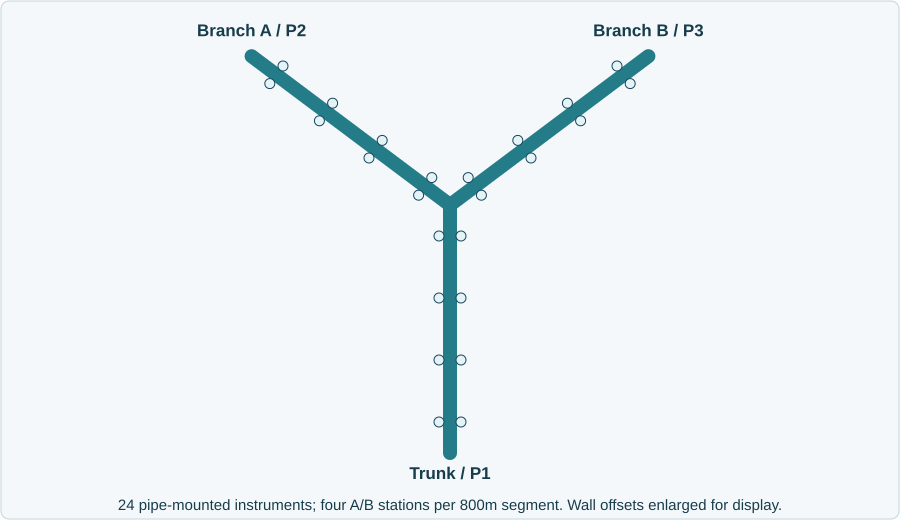

# Subsea Integrity Copilot - Customer Brief

**Customer, problem and users.** NorthSea Integrity Operations is a fictional
offshore oil-and-gas operator; this demo focuses on its gas pipelines.
Monitoring, integrity and instrumentation engineers must distinguish a possible
leak from sensor faults or shared telemetry outages, then choose what to inspect.
The agent is a read-only evidence layer over existing monitoring workflows,
not a replacement dashboard or safety system.

**Why I chose this problem.** It builds on my PhD research in marine sensor
data quality and anomaly detection. The practical question is whether unusual
readings point to a real pipeline problem or faulty sensors. This is a useful
FDE case because engineers need evidence they can check before deciding what to
inspect, not just another alarm or chatbot answer. Leak localization is a
simplified demo extension, not a capability validated by my thesis.

**Why the prospect has not signed.** Their existing dashboard is cheaper, and
errors have two costly sides. False alarms can trigger unnecessary offshore
personnel, vessel or ROV mobilization and operational disruption. Missed releases
risk environmental harm; oil-line spills also bring cleanup and liability.
Serious regulatory violations can put licences at risk, including potential
revocation under applicable law. They need evidence that AI reduces investigation
effort without increasing missed-event risk, integration burden or data exposure.

**Business stakeholder: Head of Subsea Operations, budget owner.** Cares about
inspection cost, delivery time, adoption, environmental exposure and accountability.
Main objections: "Will fewer alarms conceal real leaks?", "What value can four
weeks demonstrate?" and "Who owns a wrong recommendation?" The ask is a bounded
shadow pilot alongside existing safety procedures, not autonomous intervention.

**Technical stakeholder: Lead Subsea Integrity & Instrumentation Engineer.**
Cares about calibration, provenance, stale/incomplete/inconsistent data,
environmental confounders and reproducible physical assumptions. Main objections:
"Could these sensors share a failed gateway?", "Could currents or acoustic noise
explain this?" and "Can I reproduce the location from raw evidence?"

**What the demo demonstrates.** Acoustic, methane and temperature data move through
60-second windows every five simulated seconds. Inputs include gaps, spikes, mixed
formats and conflicting duplicates. Three agents answer: possible leak or sensor
issue? Where should we inspect? What evidence is missing? **Leak example:** the
recorded S1 window suggests P1 near 375m, between the 300m and 500m stations.
**Sensor-fault example:** S2 has scattered spikes at P1-ST1-A, P2-ST2-A and
P3-ST4-A. Numerical tools calculate; agents interpret checked evidence. Raw records,
pinned answers and execution receipts remain inspectable; insufficient coverage
means abstention, not an all-clear.

**Assumptions and limitations.** The customer, network and telemetry are synthetic;
no confidential employer data is used. Methane/acoustic signatures model gas,
not validated oil-spill detection. Geometry, baselines and failure domains are
assumed. Acoustic distance-decay fitting provides a
compatible inspection candidate, not an exact leak position or calibrated confidence
interval. Synthetic qualification is not field reliability. Missingness does not
prove a leak or a particular hardware failure. Copilot inference is hosted, not
local-only; only synthetic evidence is sent. No live historian/platform connector,
certified detection, shutdown/control or production security certification is
claimed. Human engineers retain inspection and safety authority.

**Proposed next step.** A conditional four-week shadow pilot on one network after
data/security approval. Compare triage effort and reviewed false alarms against
existing workflows; separately assess missed-event sensitivity with labeled events
or validated tests. Track coverage and latency; poor coverage is not a healthy
pipeline. Agree pricing, savings assumptions and safety/acceptance gates before work.

**Private demo repository:** https://github.com/ntnguyen-so/subsea-integrity-copilot
