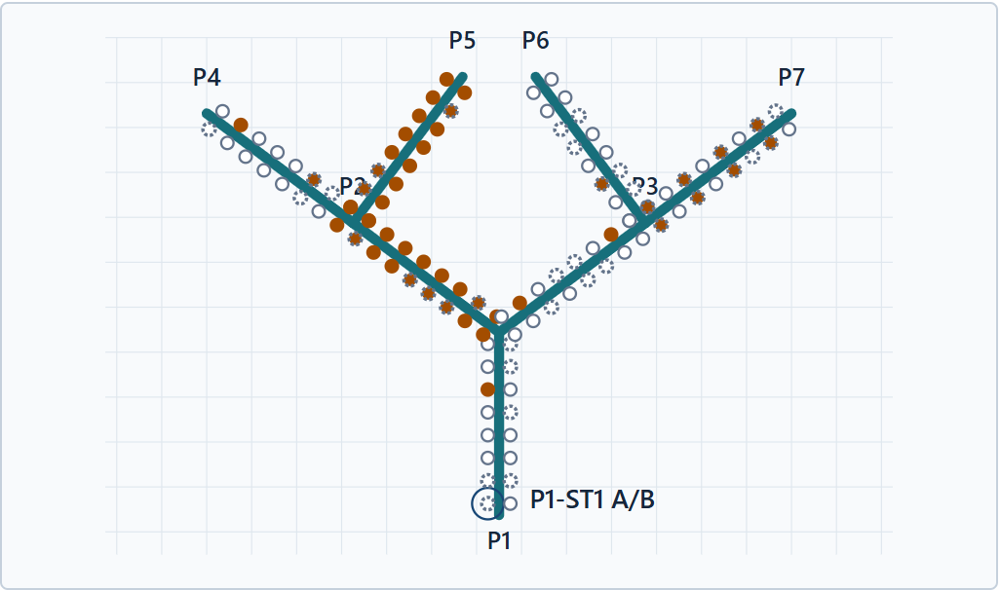
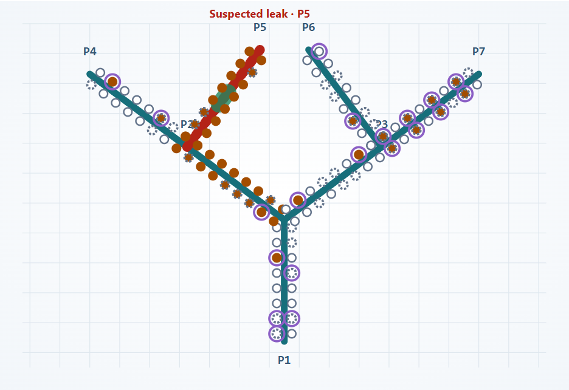

# Subsea Lens - Customer Brief

Subsea pipelines carry oil and gas from offshore fields. Operators monitor pressure along these pipelines to spot possible problems and decide when to intervene. A missed leak can harm the marine environment, stop production and put operating permissions at risk. But sending a vessel or underwater inspection team to investigate faulty measurements can also be costly. The integrity engineer must therefore distinguish a real pipeline problem from a measurement problem before directing a response.

Making that distinction is difficult because different causes can produce similar alerts. A pressure drop may indicate a leak, an operating change or a faulty sensor; missing readings can obscure the picture. A leak and sensor faults may also occur together. Before directing a response, the engineer must establish what is happening, where attention is needed and whether the evidence is reliable enough to act on. This turns each investigation into three practical questions:

1. Is this a leak, a change in operating or measurement conditions, or an instrument problem?

2. If a leak is suspected, which branch and section should be inspected?

3. What evidence supports that conclusion, and what still needs checking before a team is sent?

The illustration below shows this challenge on a simulated 11.2 km network with seven connected sections (P1-P7) and 112 pressure instruments. A leak on P5 occurs alongside sensor faults, missing data and a shared data-connection problem on P7. Both maps summarize the same 60-second slice of simulated readings of scenario S7 (see the live tab of the dashboard), from 50 to 110 seconds into the replay, with 69 instruments flagged.

Figure 1. Sensor alerts only. Orange dots show unusual pressure; dashed dots show missing or invalid readings. Question 1 requires comparing histories and records to separate the P5 leak from P7's connection problem and sensor faults. Question 2 requires tracing related pressure changes across branches to narrow the inspection area. Question 3 requires checking sensor reliability and documenting the supporting evidence. The map alone answers none of these: repeated cross-checks take time and require knowledge of pipeline behavior.

Subsea Lens organizes these cross-checks with **three AI agents working in sequence**. Sensor Quality checks reading reliability. Event Diagnosis uses that assessment, pressure patterns and records to assess causes and inspection priorities. Operator Response assembles the findings, evidence, uncertainties and next checks into one report. A separate review checks the report against its sources.

Figure 2. The agents add an explanation to the alerts in Figure 1. Red highlights P5 because the report finds evidence of a possible leak there. Green narrows the inspection priority to 700-900 m from P5's start. Purple rings identify separate sensor or data concerns. These markings summarize the report. The report explains which readings and records support each finding, considers other possible causes and lists the next checks. The engineer can follow those references, challenge the reasoning and decide what to inspect, instead of assembling the investigation from individual alerts.

Subsea Lens can generate reviewed reports in about **2.5-2.8 minutes**, as observed in two controlled tests, helping engineers respond promptly to pipeline issues.

To test the system's answers, we compared its findings with known leaks and instrument problems that were hidden from the agents. Across all evaluated snapshots in the held-out synthetic detection test, leak detection achieved **100% precision and recall, with no false leak alarms**. Identifying affected instruments and classifying their problems also achieved **100% precision and recall**.

[Dashboard (local)](http://127.0.0.1:8086/?tab=live). [Evaluation (local)](http://127.0.0.1:8086/?tab=evaluation). [Run the demo](https://github.com/ntnguyen-so/subsea-integrity-copilot). [Evidence and results](https://github.com/ntnguyen-so/subsea-integrity-copilot/blob/main/docs/RESULTS.md).
