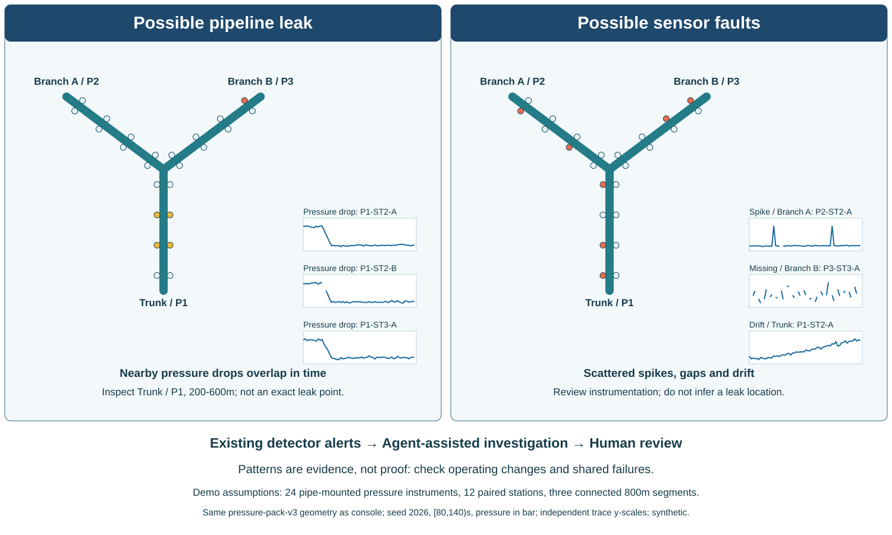

# Subsea Integrity Copilot - Customer Brief

**Prospect and problem.** NorthSea Integrity Operations is a fictional offshore
gas operator. Engineers must distinguish pipeline leaks from sensor spikes,
gaps and drift. Missed leaks threaten the environment and operations; false
alarms trigger costly inspections. Scarce expertise is difficult to encode and
transfer to newcomers.

**Why this problem.** My PhD studied marine data quality, anomaly detection and
translating expertise into smart systems. This applies that experience to reviewable investigation.

**The two customer roles.** The **Head of Subsea Operations** owns the budget:
cost, workload, timeline and risk. The **Lead Subsea Integrity & Instrumentation
Engineer** challenges calibration, shared failures, missing data and unsupported
conclusions. Integrity/instrumentation engineers and newcomers use the copilot.

**Why unsigned.** Doubts about effort savings, hallucinations, missed leaks,
integration cost, privacy and accountability. Cheaper fixed workflows are credible alternatives.

**Working demo.** An upright Y has three 800m pipes and 24 pressure instruments
in 12 paired stations. Frozen median/MAD detection feeds sliding-window timing,
topology and failure-domain analysis. Nearby sustained drops support inspection
intervals; scattered faults trigger sensor review; inadequate evidence withholds
conclusions. Questions: "Leak or faulty sensors?", "Where should we inspect,
and why?" and "What evidence supports this, and what remains unknown?"

**Agent value.** Three scoped roles investigate quality, choose incident-time
history searches/comparisons and explain competing causes. A separate same-model
critic reviews original sources; code checks quotes, coverage and result identity.
Revise once, then accept or withhold. Engineers inspect sources, ask follow-ups
and download evidence. Reviewed procedures support knowledge reuse, not automatic expertise acquisition.

**Limits and buying gate.** Fictional dirty/conflicting data; unvalidated hydraulics;
intervals, not exact leak positions. Hosted reports: 15/18 first attempts passed,
then 3/3 explicit retries. Fixed reports: 18/18 and faster. No field-accuracy or
hallucination-free claim. Numerical warnings never wait for inference. Assume
ten-minute manual analysis; target five-minute reports, counting failures and
human review separately. Propose a four-week read-only shadow pilot with agreed
accuracy, abstention, unsupported-claim, latency and cost gates. Pricing requires
discovery; savings are unproven and connectors unbuilt. Hosted inference requires
approval. Humans retain safety authority. Buy only if quality, effort and total
cost beat manual/fixed baselines.

**Private GitHub and run instructions:** [github.com/ntnguyen-so/subsea-integrity-copilot](https://github.com/ntnguyen-so/subsea-integrity-copilot). Repository access must be granted before review.
